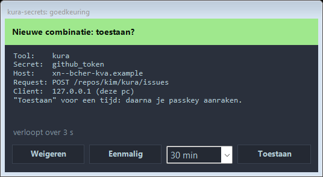
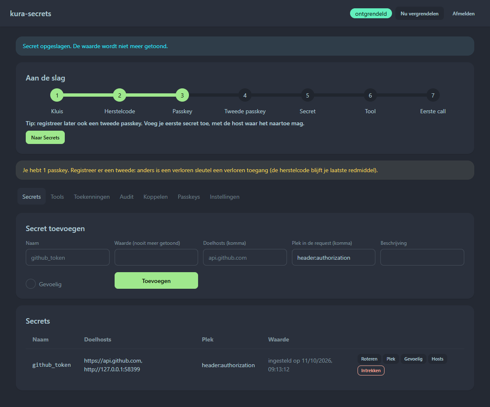
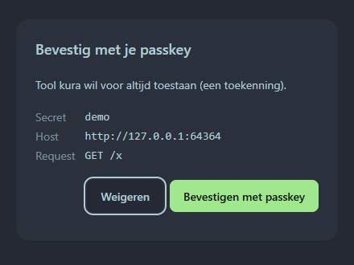

# Vaultgate: the secrets gate for AI agents

[](https://github.com/kimVanRenterghemNew/Vaultgate/actions/workflows/ci.yml)
[](https://kimvanrenterghemnew.github.io/Vaultgate/)
[](LICENSE)

**Your AI agents use your API keys. They never see them.**

Vaultgate is a local proxy. The agent sends a placeholder; Vaultgate swaps in the real key as the request leaves your computer, and only for the tool, host and place in the request that you allowed.

Website: **[kimvanrenterghemnew.github.io/Vaultgate](https://kimvanrenterghemnew.github.io/Vaultgate/)**



> **Preview.** The code arrives in this repository with the first release. The npm package is not published yet. The interface is in Dutch for now; English is next.

## Why

An agent that knows your API key can leak it: through a prompt injection in a web page or an email, in a log or a reply, or through a malicious plugin. Once a key has been in a model's context, treat it as leaked.

With Vaultgate the agent only holds a **placeholder** (`{{secret:github_token}}`). The proxy inserts the real value into the outgoing request at the last moment, and only:
- to a host you allowed;
- in a place you allowed (a header, not a query string or a free-text field);
- for a tool you allowed.

Responses are scrubbed before the agent sees them, including base64 and hex copies of the value.

## Principles

- **Closed by default.** Every request passes nine checks before the secret is decrypted, among them the tool key, the client address, the target host, the place in the request, and a grant or approval. The audit is fail-closed: if the audit entry cannot be written, the request is refused.
- **Proof, not promises.** `npm run attack` runs the attack bench against the real process with fake secrets. Today: 22 attacks, 17 blocked, 5 still open, each with the reason. No secret appeared in any output. The full table is published with the first release.
- **Local and offline.** No account, no cloud, no telemetry. Planned: connectors for the vault you already use (Bitwarden and Bitwarden Secrets Manager, Azure Key Vault, AWS, HashiCorp Vault/OpenBao, 1Password), so you don't manage a secret twice.
- **Open source, no subscription.** Built on libsodium (XChaCha20-Poly1305, Argon2id) and passkeys with PRF (FIDO2/WebAuthn). Tested against the real process, with property tests and a leak test that searches every output for recognizable fake secrets.

## How it works

```
curl http://127.0.0.1:8484/forward/https://api.github.com/user \
  -H "x-kura-tool-key: ks_…" -H "Authorization: Bearer {{secret:github_token}}"

200 · x-kura-rule: granted      (the real token went to api.github.com, and nowhere else)
```

- **Every decision has a name.** One decision table; the first matching rule wins. The rule name is in the response (`x-kura-rule`) and in the encrypted audit log: `target-host-not-allowed`, `placeholder-location-not-allowed`, `tls-chain-changed`, `throttled`, …
- **You approve in the system tray.** A new combination of tool, secret and host asks for your OK and shows the method and path. *Once* allows exactly one request. A grant for 30 minutes, 1 hour, 4 hours or forever also needs a **passkey touch**: a program can click a button, but it cannot touch your security key.
- **Silent or noisy grants.** A grant can let a tool through silently, or notify you each time it uses the key.
- **Key guessing is throttled.** After 5 wrong tool keys in 3 minutes, the proxy stops answering for a while and tells you.
- **The vault** follows the Bitwarden model. Everything is encrypted, including names, hosts, grants and the audit log. You unlock it with a passkey.
- **The portal** listens on localhost only and opens in its own browser window without extensions. It has passkey login, CSRF protection, a Host check against DNS rebinding, and a nonce-based CSP.
- **TLS chain pinning.** The proxy validates against your operating system's certificate store and remembers each host's chain. If the chain changes, nothing is sent until you decide.
- **Integrations:** a forward proxy for any HTTP API, reverse routes (for example `ANTHROPIC_BASE_URL`), a git credential helper, an `apiKeyHelper` for Claude Code, and a device flow that links a tool without copying a key.

| | |
|---|---|
|  |  |
| Secrets: the value goes in and never comes back out. | A grant needs a touch of your passkey. |

The security model, the architecture and the Claude Code setup are published with the first release.

## Install

The goal is one command, then a welcome window that walks you through setup:

```
npm i -g vaultgate     # not published yet
vaultgate
```

Once the code is here, you can also run it from source: Node 24, then `npm ci` and `node src/main.js`.

Windows comes first. The tray uses PowerShell 5.1 and .NET Framework 4.8, both built into Windows 10 and 11, so there is nothing extra to install. macOS and Linux are planned.

## License

[GPL-3.0](LICENSE).
