# Vaultgate: the secrets gate for AI agents

[](https://github.com/kimVanRenterghemNew/Vaultgate/actions/workflows/ci.yml)
[](https://kimvanrenterghemnew.github.io/Vaultgate/)
[](LICENSE)

**Your AI agents use your keys. They never see them.**

Vaultgate is a local gate between your AI agents and the internet. An agent sends a placeholder. Vaultgate fills in the real key as the request leaves your computer, and only for the tool, the host and the place in the request that you allowed.

Website: **[kimvanrenterghemnew.github.io/Vaultgate](https://kimvanrenterghemnew.github.io/Vaultgate/)** · [Tour of every screen](https://kimvanrenterghemnew.github.io/Vaultgate/tour.html) · [Security architecture](https://kimvanrenterghemnew.github.io/Vaultgate/security.html)

| Light (Harborlight) | Dark (Dracula) |
|---|---|
| 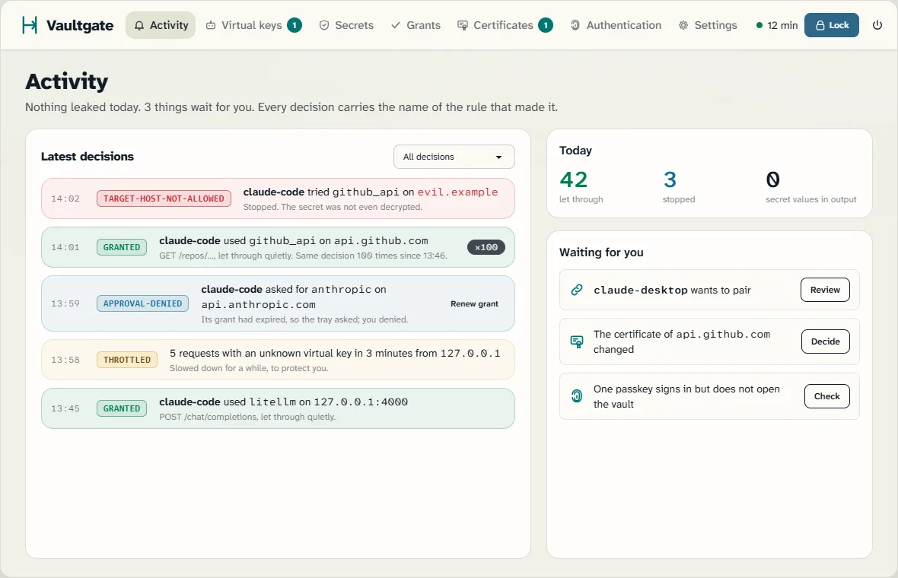 | 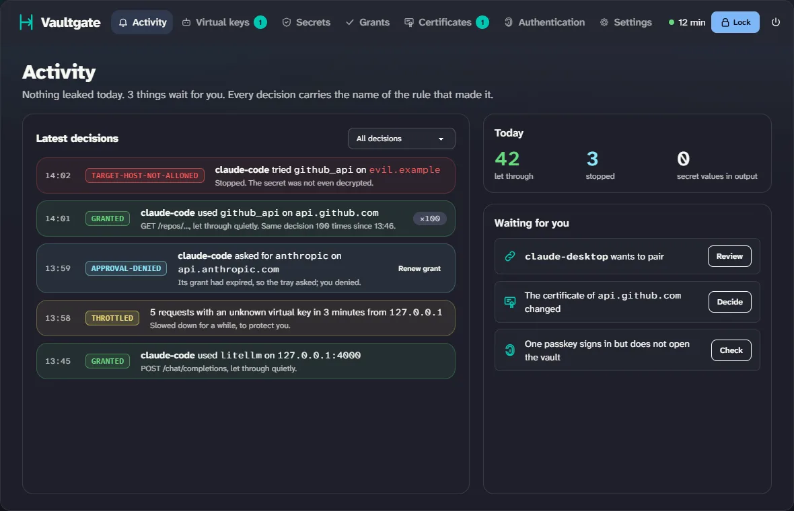 |

> **Preview.** The code arrives in this repository with the first release. The npm package is not published yet. The screenshots are the approved designs the portal is being built to; the shipped portal may still differ.

## Why

An agent that knows your API key can leak it: through a prompt injection in a web page or an email, in a log or a reply, or through a plugin that is not what it says. Once a key has been in a model's context, treat it as leaked.

With Vaultgate the agent only holds a **placeholder** (`{{secret:github_token}}`) and a tool key of its own that works nowhere else. Vaultgate fills in the real value at the last moment, and only:
- for a tool you allowed.
- to a host you allowed.
- in a place you allowed (a header, not a query string or a free-text field).

Replies are scrubbed before the agent sees them, including base64 and hex copies of the value.

## How one request travels

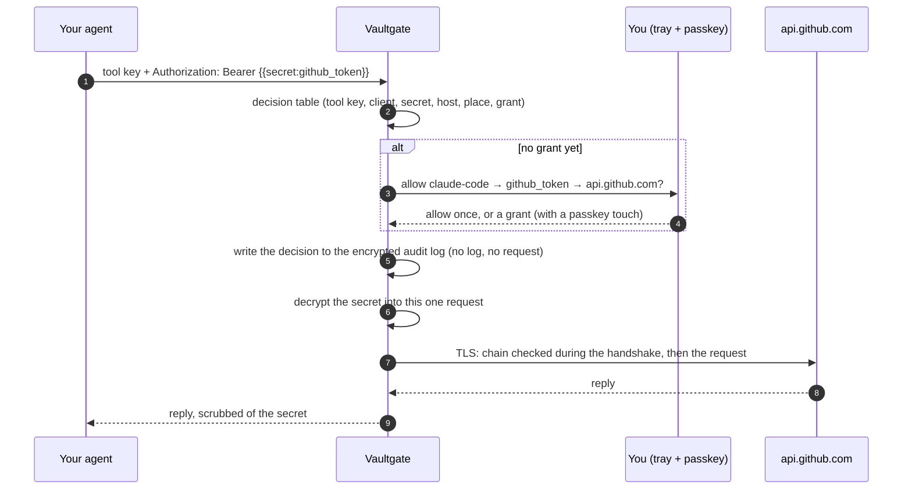

Any refusal happens before the secret is decrypted, and carries the name of the rule that made it.

```
curl http://127.0.0.1:8484/forward/https://api.github.com/user \
  -H "x-vault-gate-tool-key: vg_…" -H "Authorization: Bearer {{secret:github_token}}"

200 · x-vault-gate-rule: granted      (the real token went to api.github.com, and nowhere else)
```

Many tools need no placeholder at all: point them at Vaultgate (reverse routes, for example `ANTHROPIC_BASE_URL`) and Vaultgate puts the key where that service expects it.

## The security model

### One decision table, first rule wins

Every request runs down the same table. The first matching rule decides; its name goes into the response (`x-vault-gate-rule`) and into the encrypted audit log.

| Rule | When |
|---|---|
| `vault-locked` | the vault is closed |
| `no-tool-key` | no valid tool key |
| `tool-key-revoked` | the tool key was revoked |
| `client-not-allowed` | from an address you did not allow |
| `no-placeholder` | nothing in the request asks for a secret |
| `unknown-secret` | no such secret |
| `target-host-not-allowed` | not a host this secret may go to |
| `placeholder-location-not-allowed` | not a place in the request it may go |
| `quiet-hours`, `grant-blocked`, `secret-blocked`, `tool-blocked` | blocks you set |
| `granted` | a grant for this tool, secret and host: **let through** |
| `grant-expired` | the grant ran out: ask again |
| `needs-approval` | otherwise: ask in the tray. no answer is no |

The table is data, not a tangle of if-statements, and every rule has a test with a request it must refuse.

### Keys inside keys

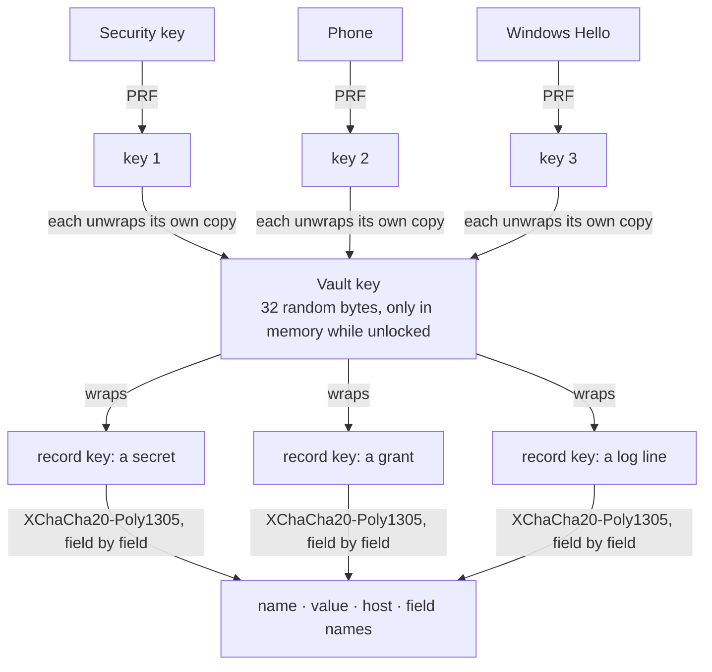

- The **vault key** is random and never derived from a password. Each passkey (through the WebAuthn PRF extension) holds its own wrapped copy; remove a passkey and only its copy goes.
- Each record has its own key, and each field is encrypted on its own, bound to its record and position, so it cannot be moved elsewhere.
- A MAC over the header and a record manifest makes a rolled-back or removed record, or a swapped-in key, fail to unlock.

### Nothing readable on disk

| Open (and no secret) | Encrypted, field by field |
|---|---|
| format version · key-derivation settings and salts · the wrapped vault keys · random record ids | secret names, values and hosts · tools and their settings · grants and approvals · settings · **the audit log, line by line** |

Tool keys are stored only as a keyed hash. You see a key once, or never (when the tool pairs itself).

### A touch, not a click

A program can click a button in a pop-up. It cannot touch your security key. Allowing once lets exactly one request through; anything that lasts (a grant, pairing a tool, a secret marked *sensitive*) asks for a touch of your passkey.

### Pairing a tool

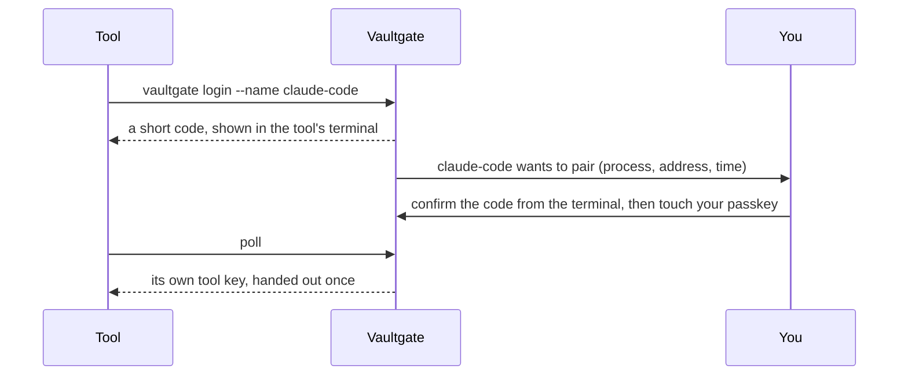

The secret behind the request is 256 bits and expires after 10 minutes. At most 5 requests wait per client address. An existing name cannot be taken over through pairing.

### Audit first, TLS checked, guessing slowed down

- **The log comes first.** A decision is written to the audit log before the secret is decrypted. If the log can't be written, nothing goes out (`audit-unavailable`). After three failures in a row the vault locks itself.
- **TLS.** Vaultgate trusts what your PC trusts, strictly, and remembers who issued each site's certificate. If that changes, the check during the handshake stops the request before a byte leaves (`tls-chain-changed`), and the portal asks you.
- **Key guessing is throttled.** After 5 wrong tool keys in 3 minutes, the proxy stops answering for a while and tells you.
- **The portal** listens on localhost only and opens in its own browser window without extensions. Passkey login, CSRF protection, a Host check against DNS rebinding, a nonce-based CSP. A secret's value goes in once and no page or API ever returns it.

### What it protects against, and what not

| Threat | What Vaultgate does |
|---|---|
| An agent or plugin reads your key | It never has one: placeholders only. |
| A prompt injection sends the key elsewhere | Hosts per secret: a new tool × secret × host asks you first. |
| The API echoes the key back | The reply is scrubbed, also across chunk boundaries and as base64 or hex. |
| Stolen disk or backup | Everything is encrypted; without a way to unlock it, it is useless. |
| A stolen tool key | Only works through Vaultgate, from allowed addresses, for what was granted. Revoke it in one click. |
| A program clicks "Allow" | Anything that lasts asks for a touch of your passkey. |
| Someone in the middle | Strict TLS: a changed certificate issuer stops the request. The first chain Vaultgate sees for a site is the one it trusts. |
| **Not covered** | Malware running as you while the vault is open can read memory. Vaultgate keeps that window small (auto-lock, wiping buffers), and says so. |

> Detailed technical specifications: see [Security Architecture & Threat Model](docs/security-architecture.md).

## A look at the portal

| | |
|---|---|
| 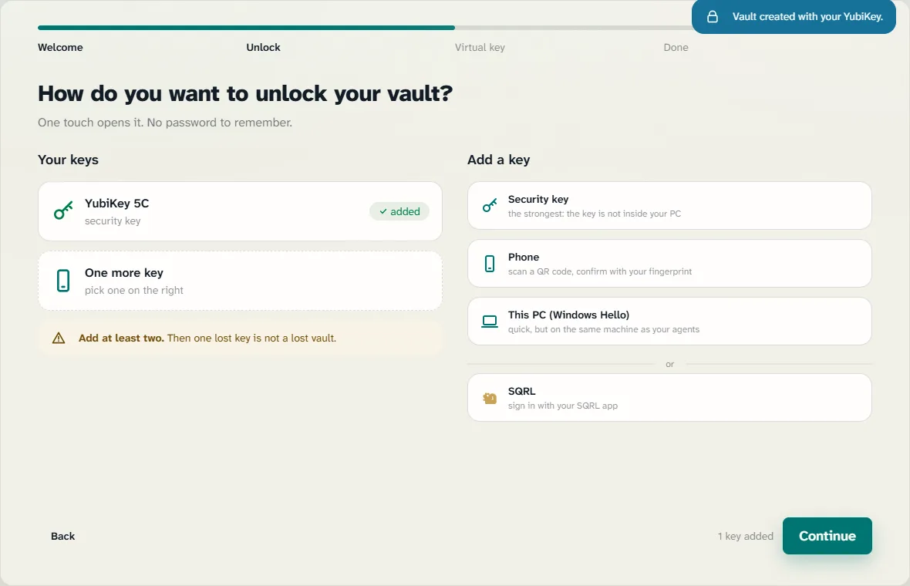 | 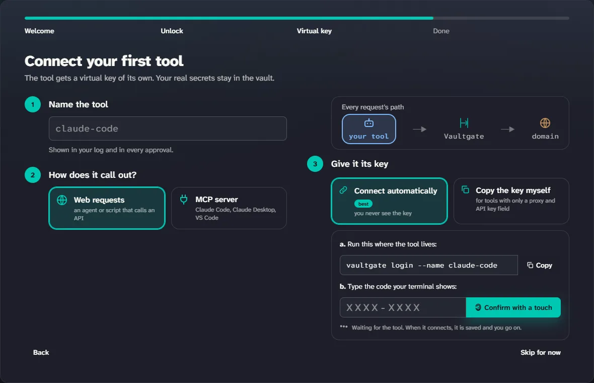 |
| **Welcome**: passkeys first, we recommend two. | **Connect a tool** in three numbered steps. |
| 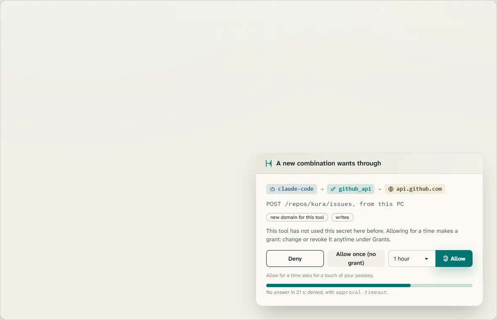 | 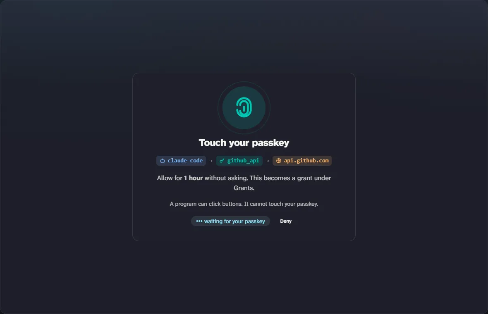 |
| **Approve in the tray**: tool, secret and host on one line. | **A touch, not a click.** |
| 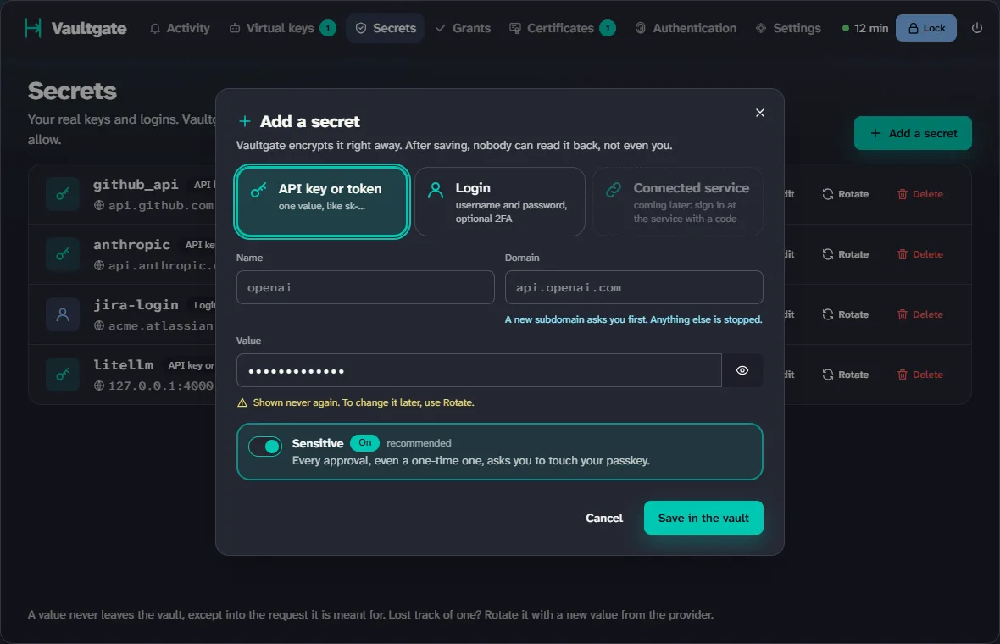 | 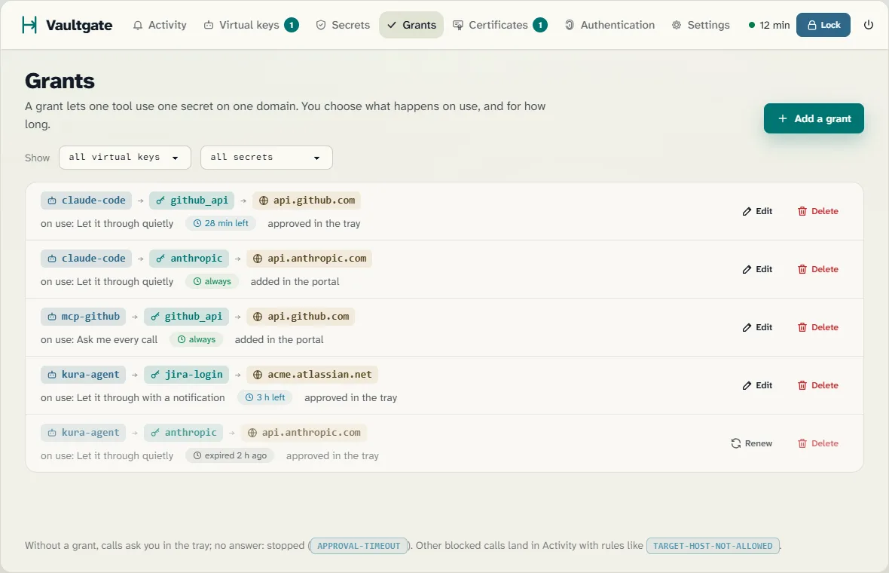 |
| **Secrets**: in once, never back out. *sensitive* on by default. | **Grants**: quietly, with a notification, or ask every time. |

Every screen, in both themes: [the tour](https://kimvanrenterghemnew.github.io/Vaultgate/tour.html).

## Proof, not promises

`npm run attack` starts the real process with fake secrets and runs every attack in the bench. The attacks come from security audits and from one question: "if you were an agent on this computer, how would you get in?" Today: **22 attacks, 17 blocked, 5 open** (each with its reason), and no secret in any output. In every test, a leak check searches all output (logs, responses, pages) for the recognizable fake secrets. The full table is published with the first release.

## Principles

- **Closed by default.** No tool key, no grant, an unknown host, the wrong place in the request: refused, without decrypting.
- **Local and offline.** No account, no cloud, no telemetry. Planned: connectors for the vault you already use (Bitwarden and Bitwarden Secrets Manager, Azure Key Vault, AWS, HashiCorp Vault/OpenBao, 1Password), so you don't manage a secret twice.
- **No home-made cryptography.** libsodium (XChaCha20-Poly1305) and passkeys with PRF (FIDO2/WebAuthn).
- **Open source, no subscription.** GPL-3.0.

## Install

The goal is one command, then a welcome window that walks you through setup:

```
npm i -g vaultgate     # not published yet
vaultgate
```

Once the code is here, you can also run it from source: Node 24, then `npm ci` and `node src/main.js`.

Windows comes first. The tray uses PowerShell 5.1 and .NET Framework 4.8, both built into Windows 10 and 11, so there is nothing extra to install. macOS and Linux are planned.

## License

[GPL-3.0](LICENSE).
