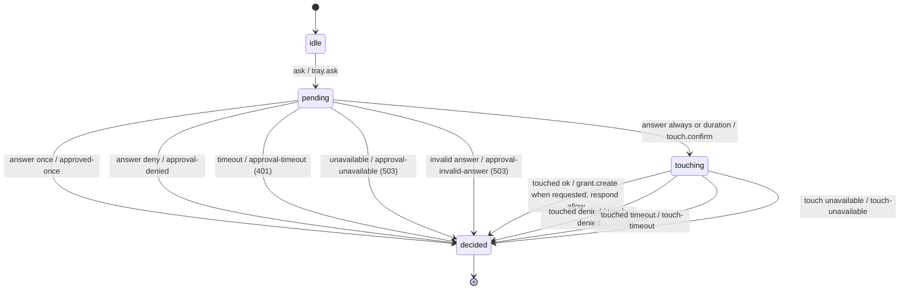
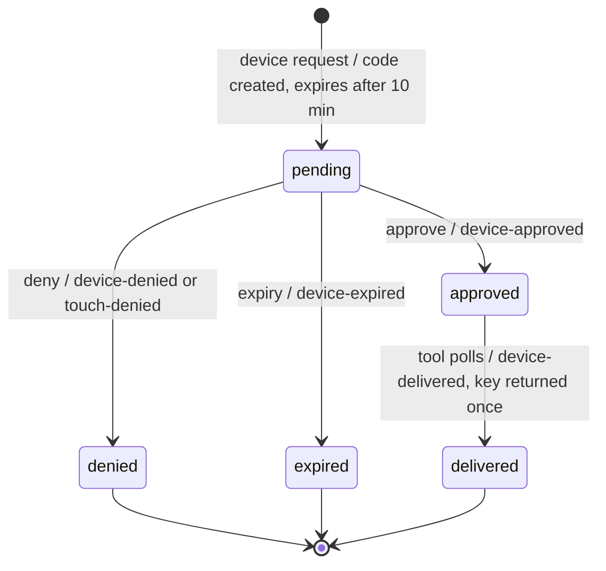
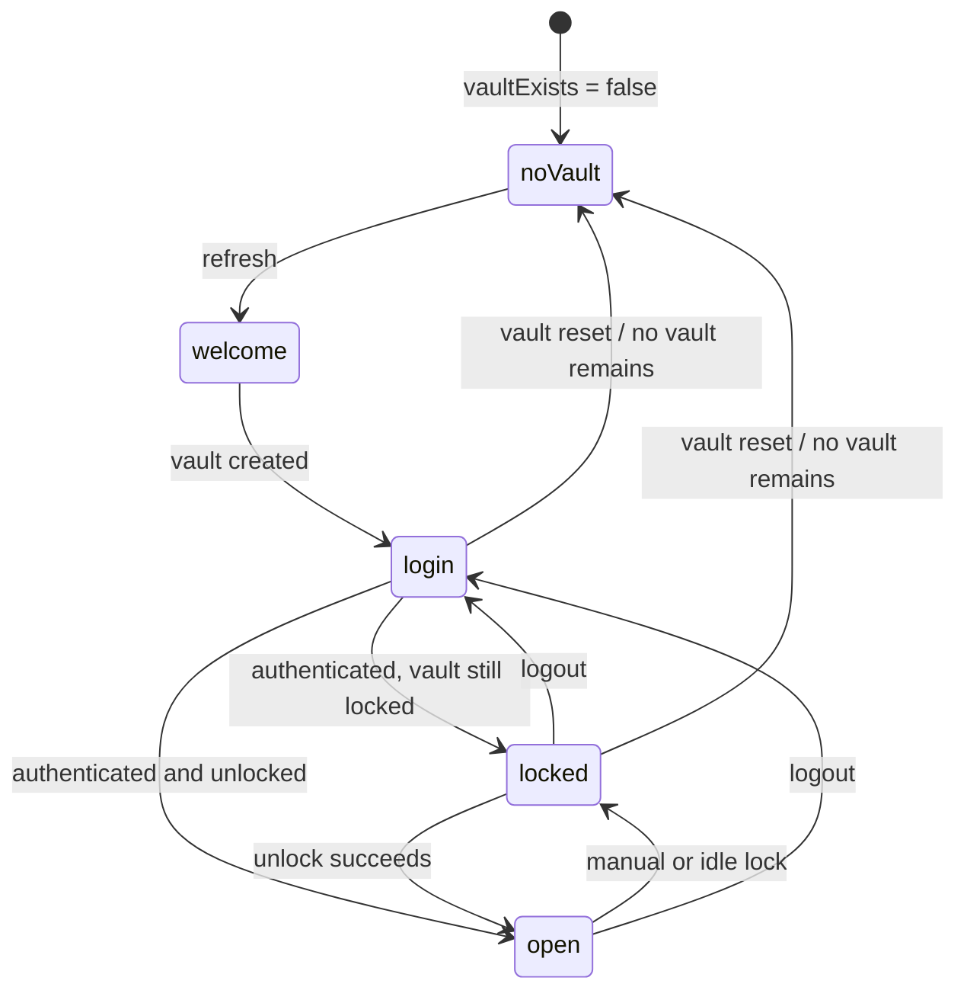

# Architecture

Two ideas shape the code: a decision core (§5) and replaceable modules behind ports (§4).

## 1. Processes

```
 tool (Claude Code, agent on a VM, …)        portal (browser, 127.0.0.1)
        │  HTTP(S) + tool key + {{secret:x}}            │ FIDO2 login
        ▼                                             ▼
 ┌──────────────────────────── Vaultgate (one Node process) ─────────────────────────────┐
 │ ingress ─► policy ─► approval ─► vault ─► egress ─► (target host)  ◄─ scrub ◄─ response│
 │                                   ▲                                                   │
 │ portal-api ───────────────────────┘          audit (encrypted, append-only)          │
 └───────────────────────────────────────────────────────────────────────────────────────┘
        ▲ local socket + its own token
        │
 tray app (a separate small app): approval pop-ups, locked/unlocked state
```

- The **proxy process** is the only one that ever holds a decrypted secret value in memory, and only while it fills in one outgoing request.
- The **tray app** and the **portal** see names and decisions, never values.

## 2. Modules (a folder is a module, `index.js` is its API)

| module | responsibility | depends on (ports) |
|---|---|---|
| `src/vault/` | key hierarchy, encrypt/decrypt, lock | `crypto`, `store`, `clock` |
| `src/store/` | storage backend (local file; external vault later) | `fs` |
| `src/registry/` | the domain on top of the vault: secrets, tools (key hash), grants, settings; never a value in a list | `vault`, `clock`, `crypto` |
| `src/crypto/` | thin layer over libsodium (sodium-native) | - |
| `src/policy/` | tool key, grant, target-host and client allowlist → a decision with a rule name | `vault` (names and rules only) |
| `src/approval/` | new combination → question to the tray, wait (30 s by default), timeout → 401 `approval-timeout` | `notifier`, `clock` |
| `src/proxy/` | ingress (forward + reverse per provider), filling in, egress, streaming | `policy`, `approval`, `vault`, `scrub`, `audit`, `http` |
| `src/scrub/` | replaces secret values in responses, also across chunk boundaries | - |
| `src/audit/` | append-only, encrypted; never values | `vault`, `store`, `clock` |
| `src/portal/` | HTTP API + UI on 127.0.0.1, FIDO2 login | `vault`, `policy`, `audit`, `webauthn` |
| `src/device/` | pairing tools with a device flow: code, approval in tray/portal, key handed out once; also the CLI client `runDeviceLogin` and the helper that exchanges the key for a token (`rotateSavedKey`, security model §3.1) | `registry`, `vault`, `audit`, `notifier`, `clock`, `crypto` |
| `src/tls/` | TLS trust (the list of valid roots: Node + a snapshot of the system store) and remembering the root per target host | `registry`, `audit`, `clock` |
| `src/window/` | the portal in a shielded window: Edge app mode with its own profile and no extensions | - |
| `src/tray-link/` | protocol to the tray app (named pipe/unix socket + token over stdin, one tray, state and "lock now") | `crypto` |
| `src/decision/` | composition core: guards, `decide` (named rules), `step` (reducer), `compose` (§5-6) | - |
| `src/touch/` | a passkey touch that a program cannot give: pending confirmations, one-time id | `clock` |
| `src/throttle/` | slowing down after failed attempts: a window per client or tool, increasing lockout | `clock` |
| `src/mcp/` | MCP server (`http_request`), installing into agents, refreshing after an update | `proxy` (over HTTP), `vault` |
| `src/composition.js` | the only place that chooses port implementations (§4) | all implementations |
| `web/portal/` | **browser code** of the portal: markup in `.html`, behaviour in web components (`components/`, one `.js` and one `.html` per element), shared building blocks in `core/`; esbuild bundles to `*.generated.js`, Tailwind to `portal.generated.css`; `src/portal/page.js` puts them together under the CSP nonce | the portal's `api` |

No `utils`/`helpers`/`common` folders: every folder is named after what it does. Node code lives in `src/`, browser code in `web/` (a different runtime, bundled); both follow the rule "import only through `index.js`" (`test/moduleApi.test.js`).

## 3. Rules

- **No `class`**, not even for errors. Objects come from factory functions; errors are tagged:
  ```js
  export const TARGET_HOST_NOT_ALLOWED = 'TARGET_HOST_NOT_ALLOWED';
  export const targetHostNotAllowed = (host) => Object.assign(new Error(`target host not allowed: ${host}`), { code: TARGET_HOST_NOT_ALLOWED });
  ```
- **Dependency inversion**: every module gets its ports as parameters (`createProxy({ policy, approval, vault, scrub, audit, http, clock })`). No module singletons, no ambient `process.env`, `console`, `Date.now()` or network in the core.
- **Replaceable ports**: a second implementation (for example `store` = HashiCorp Vault) is one folder + one registration + the shared contract test, without changing an existing file outside the registration.
- **Decisions have a name**: `policy.decide(request)` returns `{ allow, rule, reason }`; `rule` is a fixed name (`no-tool-key`, `tool-key-revoked`, `no-grant`, `auth-shape-changed`, `target-host-not-allowed`, `web-tool-required`, `client-not-allowed`, `needs-approval`, `approval-timeout` (HTTP 401), `approval-denied` (HTTP 403), `approved-once`, `approved-always`, `vault-locked`). The audit, the response and the tests use the same name. New rules go in the table, not as a stray `if` somewhere.
- **Closed by default**: an unknown situation is a refusal with a rule name, never a silent pass.
- **The HTTP status follows the rule**: **401** when the identity does not check out (`no-tool-key`, `tool-key-revoked`, `token-required`, `key-reuse-detected`) and on `approval-timeout` (a product decision: no answer within 30 s); **403** when the tool is known but not allowed to do this (`no-grant`, `target-host-not-allowed`, `web-tool-required`, `client-not-allowed`, `approval-denied`); **423** on `vault-locked`. Also built: **400** `no-placeholder`, `bad-target`; **403** `unknown-secret`; **404** `unknown-route`; **405** `tunnel-not-supported`; **502** `upstream-error`, `unsupported-encoding`; **503** `approval-unavailable` (no tray), `approval-invalid-answer`. Every proxy response carries the rule in `x-vault-gate-rule`.
- **Narrow output**: error messages to a tool name the rule and the secret's **name**, never its value or the decrypted configuration.

## 4. Ports and composition

Four parts per replaceable place (a "port"), no more:

1. **Port** = a small contract (a JSDoc typedef) in the module that **uses** it, for example `Store = { read(id), write(id, record), list(), remove(id) }`, `Notifier = (question) => Promise<'once'|'always'|'deny'|'timeout'>`.
2. **Implementations** in a subfolder per implementation, each with its own `index.js`: `src/store/local/`, `src/store/memory/` (later `src/store/hashicorp/`).
3. **Contract test** in `test/ports/<port>.contract.test.js` that runs the same behaviour requirements over **every** registered implementation (`describe.each(implementations)`). An implementation only counts as "added" once it passes.
4. **Composition in one place**: `src/composition.js` is the **only** place that chooses implementations (based on configuration). Other modules get the port as a parameter. Enforced by `test/composition.test.js`.

Adding an implementation = one new folder + one line in `src/composition.js`; the contract test runs over it automatically.

**Ports in Vaultgate** (only where a second implementation exists or is planned):

| port | implementations | why replaceable |
|---|---|---|
| `store` | `local` (encrypted file), `memory` (tests); later `hashicorp`/`bitwarden`/`azure` | external vault (a product requirement) |
| `notifier` (approval) | `tray` (C#/WinForms helper over a named pipe), `fake` (tests); later for example a portal notification | Windows only; CI and other platforms use `fake` |
| `crypto` | libsodium (sodium-native), `fake` only for error paths | the library choice may change |
| `providerRoute` | `anthropic`, `openaiCompatible` (LiteLLM, …) | new providers |
| `clock`, `http` | real, fake | testability (30 s timeout, streaming) |

**Not replaceable** (no port, no configuration that bypasses it): the decision rules of `policy` (closed by default, target-host allowlist, tool key), scrubbing, and "never a value in output". A plug-in can provide new storage, but it cannot decide who gets access; a `store` that says "allowed" by itself is rejected by a contract test.

**Deliberately not**: no DI framework, no dynamic loading of external plug-ins, no magic registry. Composition is plain code you can read. No port without a second reason; otherwise it stays a function parameter.

## 5. Composition core: deciding with named rules

Minimal, pure, no I/O, no library (`src/decision/`):

```js
// guards and composition
const all = (...g) => ctx => g.every(f => f(ctx));
const any = (...g) => ctx => g.some(f => f(ctx));
const not = g => ctx => !g(ctx);

// decision table: the first rule that matches wins; every rule has a name
decide(ctx, [
  { name: 'no-tool-key',             when: ctx => !ctx.tool,                  then: { allow: false, status: 401 } },
  { name: 'tool-key-revoked',        when: ctx => ctx.tool.revoked,          then: { allow: false, status: 401 } },
  { name: 'target-host-not-allowed', when: not(hostAllowed),                 then: { allow: false, status: 403 } },
  { name: 'needs-approval',          when: not(hasGrant),                    then: { allow: false, ask: true } },
  { name: 'granted',                 when: () => true,                       then: { allow: true } },
]) // -> { allow, status, rule: 'target-host-not-allowed' }

// transition: a pure reducer, effects as data (for example the approval flow)
step(state, event) // -> { state, effects: [{ type: 'audit.append', ... }, { type: 'tray.ask', ... }] }
```

- `decide` returns the **name of the rule**; that name is in the audit, in the response to the tool and in the test. "Why 403?" → rule `target-host-not-allowed`.
- Effects are data; a thin executor does the I/O (audit, tray, network). That way every decision and every transition can be tested without a network or a clock.
- Used here from day one: `policy` (access), `approval` (pending → once/always/denied/timeout after 30 s → 401), the client allowlist. Three consumers with the same shape: exactly the condition for building a core.
- **Not**: a hierarchy of blocks, `enter/exit` hooks, a scheduler, parallelism.

### 5.1 State machines

The diagrams show the explicit states and events from `src/approval/`, `src/device/` and
`web/portal/core/state.js`. Effects remain output data of `step`; the caller does the I/O.

#### Approving a request



`once` allows only this request. `always` and time-limited answers create a grant only after a
successful touch. A sensitive secret asks for a touch even for a one-time approval. Late answers
after `decided` do not change the outcome.

#### Pairing a tool



A second decision on a request that is already settled is invalid. The device key does not stay in
the request after it is handed out.

#### Portal and vault



The UI derives the active view from `/api/state`: `welcome`, `login`, `unlock` or `main`. The
header status is `none`, `locked` or `open`; `welcoming` keeps the setup flow visible until it is
explicitly finished.

## 6. Composing behaviour per request

The request pipeline (ingress → policy → approval → fill in → egress → scrub) may be built as a **trampoline with named behaviours**, with these adjustments:

```js
const PROTECTED = ['requestId', 'toolId', 'secretName', 'targetHost', 'decision'];
export const compose = (rt, b) => {
  const bad = PROTECTED.filter(k => k in b.patch);
  if (bad.length) throw protectedKeyError(b.name, bad);          // tagged error, no class
  return Object.freeze({ ...rt, ...b.patch, behaviors: [...rt.behaviors, b.name] });
};
// while (!rt.done) rt = await BEHAVIORS[rt.behaviors.at(-1)].step(rt);
```

- Every step returns a **new, frozen** object; the input is never mutated.
- **Protected keys**: no behaviour may overwrite the identity of the request or the decision (a "clever" behaviour cannot turn a refusal into an approval).
- State is data; behaviour sits in a registry by name (serialisable, explainable in the audit).
- Only introduce this once the pipeline is more than a straight line (for example a retry or an extra approval); until then they are plain functions in a row.

## 7. Module tests

| level | what | where |
|---|---|---|
| module | behaviour of one module through its `index.js`, ports as doubles (`memory` store, `fake` notifier, fake clock) | `test/<module>/*.test.js` |
| decision rules | every rule in a `decide` table gets a scenario that makes it win, plus the order (first rule wins) | `test/<module>/rules.test.js` |
| port contract | the same requirements over every implementation (`describe.each`) | `test/ports/<port>.contract.test.js` |
| composition | only `src/composition.js` chooses implementations | `test/composition.test.js` |
| journey | the real process, a temporary vault, a fake target server, ending with `findLeaks` | `test/<module>/*.journey.test.js` |

## 8. Enforcement (active, `npm run check` + CI)

| rule | test |
|---|---|
| no `class` | `eslint.config.js` |
| imports between modules go through `index.js`, every folder in `src/` has an `index.js`, no dumping-ground folders | `test/moduleApi.test.js` (no baseline: every violation fails) |
| tests import through `index.js` (except `*.internal.test.js`) | `test/testModuleApi.test.js` |
| tests never see real secrets or the real vault; temp is cleaned up | `test/setup/isolate.js` |
| no secret value in output | `test/helpers/secretLeak.js` (`findLeaks`), every journey test ends with it |
| coverage | `vitest.config.js` thresholds as a ratchet (they only go up) |
