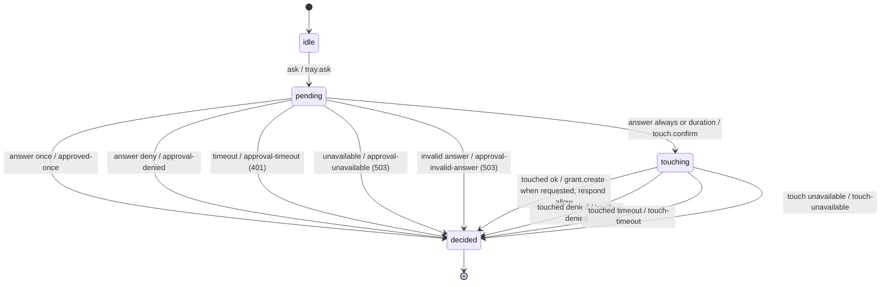
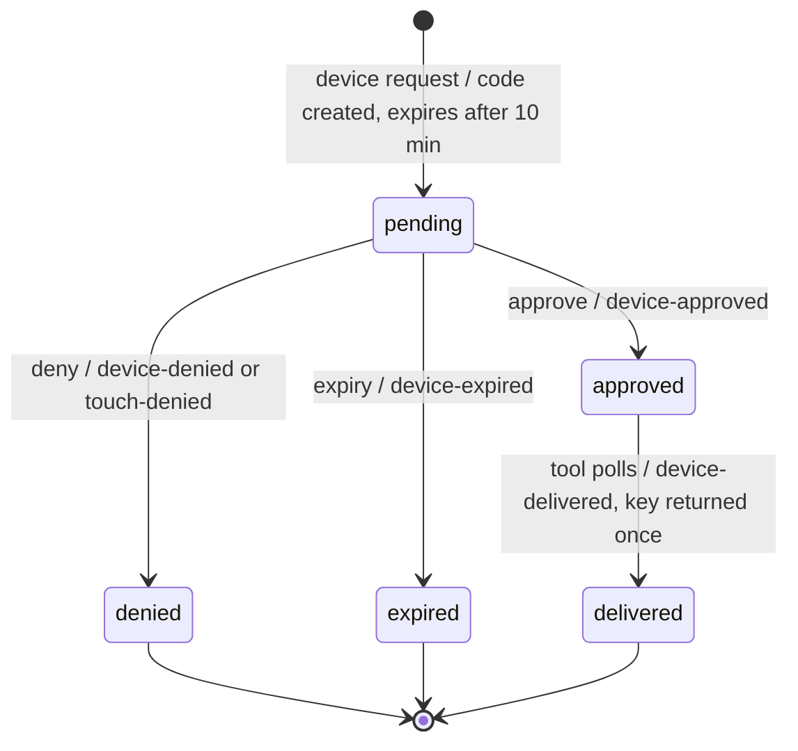
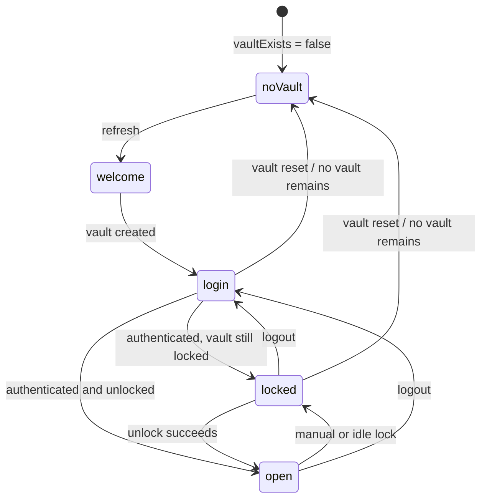

# Architectuur

Twee concepten bepalen de vorm: een beslissingskern (§5) en vervangbare modules achter poorten (§4), zie ook `docs/project-conventions.md`.

## 1. Processen

```
 tool (Claude Code, agent op VM, …)          portaal (browser, 127.0.0.1)
        │  HTTP(S) + tool-key + {{secret:x}}          │ FIDO2-login
        ▼                                             ▼
 ┌──────────────────────────── Vaultgate (één Node-proces) ──────────────────────────────┐
 │ ingress ─► policy ─► approval ─► vault ─► egress ─► (doelhost)  ◄─ scrub ◄─ response │
 │                                   ▲                                                   │
 │ portal-api ───────────────────────┘          audit (versleuteld, append-only)        │
 └───────────────────────────────────────────────────────────────────────────────────────┘
        ▲ lokale socket + eigen token
        │
 tray-app (aparte kleine app): pop-ups voor goedkeuring, toestand vergrendeld/ontgrendeld
```

- Het **proxy-proces** is het enige dat ooit een ontsleutelde secret-waarde in het geheugen heeft, en alleen tijdens het invullen van één uitgaande request.
- De **tray-app** en het **portaal** zien namen en beslissingen, nooit waarden.

## 2. Modules (map = module, `index.js` = API)

| module | verantwoordelijkheid | hangt af van (poorten) |
|---|---|---|
| `src/vault/` | sleutelhiërarchie, versleutelen/ontsleutelen, vergrendelen | `crypto`, `store`, `clock` |
| `src/store/` | opslag-backend (lokaal bestand; externe vault later) | `fs` |
| `src/registry/` | domein bovenop de kluis: secrets, tools (key-hash), toekenningen, instellingen; nooit een waarde in een lijst | `vault`, `clock`, `crypto` |
| `src/crypto/` | dunne laag over libsodium (sodium-native) | - |
| `src/policy/` | tool-key, toekenning, doelhost- en client-allowlist → beslissing met regelnaam | `vault` (alleen namen/regels) |
| `src/approval/` | nieuwe combinatie → vraag aan de tray, wachten (standaard 30 s), time-out → 401 `approval-timeout` | `notifier`, `clock` |
| `src/proxy/` | ingress (forward + reverse per provider), invullen, egress, streaming | `policy`, `approval`, `vault`, `scrub`, `audit`, `http` |
| `src/scrub/` | secret-waarden in antwoorden vervangen, ook over chunk-grenzen | - |
| `src/audit/` | append-only, versleuteld; nooit waarden | `vault`, `store`, `clock` |
| `src/portal/` | HTTP-API + UI op 127.0.0.1, FIDO2-login | `vault`, `policy`, `audit`, `webauthn` |
| `src/device/` | tools koppelen met een device flow: code, goedkeuring in tray/portaal, key één keer uitgeleverd; ook de CLI-client `runDeviceLogin` en de helper die de key inwisselt voor een token (`rotateSavedKey`, security-model §3.1) | `registry`, `vault`, `audit`, `notifier`, `clock`, `crypto` |
| `src/tls/` | TLS-vertrouwen (lijst van geldige roots: Node + momentopname van de systeemstore) en de root per doelhost onthouden | `registry`, `audit`, `clock` |
| `src/window/` | het portaal in een afgeschermd venster: Edge app-modus met eigen profiel zonder extensies | - |
| `src/tray-link/` | protocol naar de tray-app (named pipe/unix-socket + token via stdin, één tray, toestand en "nu vergrendelen") | `crypto` |
| `src/decision/` | compositiekern: guards, `decide` (benoemde regels), `step` (reducer), `compose` (§5-6) | - |
| `src/touch/` | een aanraking van de passkey die een programma niet kan geven: wachtende bevestigingen, eenmalig id | `clock` |
| `src/throttle/` | vertragen na foute pogingen: venster per client of tool, oplopende blokkade | `clock` |
| `src/composition.js` | de enige plek die implementaties van poorten kiest (§4) | alle implementaties |
| `web/portal/` | **browsercode** van het portaal: opmaak in `.html`, gedrag in webcomponents (`components/`, één `.js` en `.html` per element), gedeelde bouwstenen in `core/`; esbuild bundelt naar `*.generated.js`, Tailwind naar `portal.generated.css`; `src/portal/page.js` voegt ze samen onder de CSP-nonce | `api` van het portaal |

Geen `utils`/`helpers`/`common`-mappen: elke map heet naar wat ze doet. Node-code staat in `src/`, browsercode in `web/` (andere runtime, gebundeld); beide volgen de regel "import alleen via `index.js`" (`test/moduleApi.test.js`), en geen bestand mengt talen of is langer dan 200 regels (`test/codeStructure.test.js`, met een lijst bestaande uitzonderingen die alleen kan krimpen).

## 3. Regels

- **Geen `class`**, ook niet voor errors. Objecten uit factory-functies; errors zijn getagd:
  ```js
  export const TARGET_HOST_NOT_ALLOWED = 'TARGET_HOST_NOT_ALLOWED';
  export const targetHostNotAllowed = (host) => Object.assign(new Error(`target host not allowed: ${host}`), { code: TARGET_HOST_NOT_ALLOWED });
  ```
- **Dependency inversion**: elke module krijgt haar poorten als parameter (`createProxy({ policy, approval, vault, scrub, audit, http, clock })`). Geen module-singletons, geen ambient `process.env`, `console`, `Date.now()` of netwerk in de kern.
- **Vervangbare poorten**: een tweede implementatie (bv. `store` = HashiCorp Vault) is één map + één registratie + de gedeelde contracttest, zonder een bestaand bestand buiten de registratie te wijzigen.
- **Beslissingen met een naam**: `policy.decide(request)` geeft `{ allow, rule, reason }` terug; `rule` is een vaste naam (`no-tool-key`, `tool-key-revoked`, `no-grant`, `auth-shape-changed`, `target-host-not-allowed`, `web-tool-required`, `client-not-allowed`, `needs-approval`, `approval-timeout` (HTTP 401), `approval-denied` (HTTP 403), `approved-once`, `approved-always`, `vault-locked`). Audit, response en tests gebruiken dezelfde naam. Nieuwe regels komen in de tabel, niet als losse `if` ergens.
- **Standaard dicht**: een onbekende situatie is een weigering met een regelnaam, nooit een stille doorgang.
- **HTTP-status volgt de regel**: **401** als de identiteit niet klopt (`no-tool-key`, `tool-key-revoked`, `token-required`, `key-reuse-detected`) en bij `approval-timeout` (keuze van de product owner: geen antwoord binnen 30 s); **403** als de tool bekend is maar dit niet mag (`no-grant`, `target-host-not-allowed`, `web-tool-required`, `client-not-allowed`, `approval-denied`); **423** bij `vault-locked`. Gebouwd: ook **400** `no-placeholder`, `bad-target`; **403** `unknown-secret`; **404** `unknown-route`; **405** `tunnel-not-supported`; **502** `upstream-error`, `unsupported-encoding`; **503** `approval-unavailable` (geen tray), `approval-invalid-answer`. Elke response van de proxy draagt de regel in `x-vault-gate-rule`.
- **Smalle uitvoer**: foutmeldingen naar een tool noemen de regel en de secret-**naam**, nooit de waarde of de ontsleutelde configuratie.

## 4. Poorten en samenstelling

Vier onderdelen per verwisselbare plek ("poort"), niet meer:

1. **Poort** = klein contract (JSDoc-typedef) in de module die haar **gebruikt**, bv. `Store = { read(id), write(id, record), list(), remove(id) }`, `Notifier = (question) => Promise<'once'|'always'|'deny'|'timeout'>`.
2. **Implementaties** in een submap per implementatie, elk met een eigen `index.js`: `src/store/local/`, `src/store/memory/` (later `src/store/hashicorp/`).
3. **Contracttest** in `test/ports/<poort>.contract.test.js` die dezelfde gedragseisen over **elke** geregistreerde implementatie laat lopen (`describe.each(implementations)`). Een implementatie is pas "toegevoegd" als ze daarvoor slaagt.
4. **Samenstelling op één plek**: `src/composition.js` is de **enige** plek die implementaties kiest (op basis van configuratie). Andere modules krijgen de poort als parameter. Afgedwongen door `test/composition.test.js`.

Een implementatie toevoegen = één nieuwe map + één regel in `src/composition.js`; de contracttest draait er vanzelf over.

**Poorten in vaultGate** (alleen waar een tweede implementatie bestaat of gepland is):

| poort | implementaties | waarom verwisselbaar |
|---|---|---|
| `store` | `local` (versleuteld bestand), `memory` (tests); later `hashicorp`/`bitwarden`/`azure` | externe vault (eis van de product owner) |
| `notifier` (goedkeuring) | `tray` (C#/WinForms-helper over een named pipe), `fake` (tests); later bv. portaal-melding | alleen Windows; CI en andere platformen gebruiken `fake` |
| `crypto` | libsodium (sodium-native), `fake` alleen voor foutpaden | bibliotheekkeuze kan wijzigen |
| `providerRoute` | `anthropic`, `openaiCompatible` (LiteLLM, …) | nieuwe providers |
| `clock`, `http` | echt, nep | testbaarheid (time-out 30 s, streaming) |

**Niet verwisselbaar** (geen poort, geen configuratie die het omzeilt): de beslisregels van `policy` (standaard dicht, doelhost-allowlist, tool-key), het scrubben, en "nooit een waarde in uitvoer". Een plug-in kan een nieuwe opslag leveren, maar kan niet beslissen wie toegang krijgt; een `store` die zelf "toegestaan" zegt, wordt door een contracttest geweigerd.

**Bewust niet**: geen DI-framework, geen dynamisch laden van externe plug-ins, geen registry met magie. Samenstelling is gewone code die je kunt lezen. Geen poort zonder tweede reden; anders blijft het een functieparameter.

## 5. Compositiekern: beslissen met benoemde regels

Minimaal, puur, geen I/O, geen bibliotheek (`src/decision/`):

```js
// guards en compositie
const all = (...g) => ctx => g.every(f => f(ctx));
const any = (...g) => ctx => g.some(f => f(ctx));
const not = g => ctx => !g(ctx);

// beslistabel: de eerste regel die past wint; elke regel heeft een naam
decide(ctx, [
  { name: 'no-tool-key',             when: ctx => !ctx.tool,                  then: { allow: false, status: 401 } },
  { name: 'tool-key-revoked',        when: ctx => ctx.tool.revoked,          then: { allow: false, status: 401 } },
  { name: 'target-host-not-allowed', when: not(hostAllowed),                 then: { allow: false, status: 403 } },
  { name: 'needs-approval',          when: not(hasGrant),                    then: { allow: false, ask: true } },
  { name: 'granted',                 when: () => true,                       then: { allow: true } },
]) // -> { allow, status, rule: 'target-host-not-allowed' }

// overgang: pure reducer, effecten als data (bv. de goedkeuringsstroom)
step(state, event) // -> { state, effects: [{ type: 'audit.append', ... }, { type: 'tray.ask', ... }] }
```

- `decide` geeft de **naam van de regel** terug; die naam staat in de audit, in de response naar de tool en in de test. "Waarom 403?" → regel `target-host-not-allowed`.
- Effecten zijn data; een dunne uitvoerder doet de I/O (audit, tray, netwerk). Zo is elke beslissing en elke overgang zonder netwerk of klok te testen.
- Toepassing hier vanaf dag één: `policy` (toegang), `approval` (wachtend → eenmalig/altijd/geweigerd/time-out na 30 s → 401), client-allowlist. Dat zijn drie consumenten met dezelfde vorm: precies de voorwaarde om een kern te maken.
- **Niet**: hiërarchie van blocks, `enter/exit`-hooks, scheduler, parallellisme.

### 5.1 Toestandsmachines

De diagrammen tonen de expliciete toestanden en events uit `src/approval/`, `src/device/` en
`web/portal/core/state.js`. De effects blijven uitvoerdata van `step`; I/O gebeurt in de aanroeper.

#### Goedkeuring van een request



`once` staat alleen deze request toe. `always` en tijdsgebonden antwoorden maken pas na een
geslaagde aanraking een toekenning. Een gevoelig secret vraagt ook bij eenmalige toestemming om
een aanraking. Late antwoorden na `decided` veranderen de uitkomst niet.

#### Koppelen van een tool



Een tweede beslissing op een al afgehandelde aanvraag is ongeldig. De device-key blijft niet in
de aanvraag na uitlevering.

#### Portaal en kluis



De UI leidt de actieve view af van `/api/state`: `welcome`, `login`, `unlock` of `main`. De
header-status is `none`, `locked` of `open`; `welcoming` houdt de setup-flow zichtbaar tot die
expliciet is afgerond.

## 6. Gedrag samenstellen per request

De request-pijplijn (ingress → policy → approval → invullen → egress → scrub) mag als **trampoline met benoemde behaviors** gebouwd worden, met deze aanpassingen:

```js
const PROTECTED = ['requestId', 'toolId', 'secretName', 'targetHost', 'decision'];
export const compose = (rt, b) => {
  const bad = PROTECTED.filter(k => k in b.patch);
  if (bad.length) throw protectedKeyError(b.name, bad);          // tagged error, geen class
  return Object.freeze({ ...rt, ...b.patch, behaviors: [...rt.behaviors, b.name] });
};
// while (!rt.done) rt = await BEHAVIORS[rt.behaviors.at(-1)].step(rt);
```

- Elke stap geeft een **nieuw, bevroren** object; de invoer wordt nooit gemuteerd.
- **Beschermde sleutels**: geen behavior mag de identiteit van de request of de beslissing overschrijven (een "slimme" behavior kan een weigering niet in een toestemming veranderen).
- Status is data, gedrag staat in een register op naam (serialiseerbaar, uitlegbaar in de audit).
- Pas invoeren als de pijplijn meer dan een rechte lijn wordt (bv. herpoging, extra goedkeuring); tot dan zijn het gewone functies na elkaar.

## 7. Moduletesten

| niveau | wat | waar |
|---|---|---|
| module | gedrag van één module via haar `index.js`, poorten als dubbel (`memory`-store, `fake`-notifier, nepklok) | `test/<module>/*.test.js` |
| beslisregels | elke regel uit een `decide`-tabel krijgt een scenario dat hem laat winnen, plus de volgorde (eerste regel wint) | `test/<module>/rules.test.js` |
| poortcontract | dezelfde eisen over elke implementatie (`describe.each`) | `test/ports/<poort>.contract.test.js` |
| samenstelling | alleen `src/composition.js` kiest implementaties | `test/composition.test.js` |
| journey | het echte proces, tijdelijke kluis, nep-doelserver, eindigt met `findLeaks` | `test/<module>/*.journey.test.js` |

## 8. Afdwinging (actief, `npm run check` + CI)

| regel | test |
|---|---|
| geen `class` | `eslint.config.js` |
| imports tussen modules via `index.js`, elke map in `src/` heeft een `index.js`, geen dumping-ground-mappen | `test/moduleApi.test.js` (zonder baseline: elke overtreding faalt) |
| tests importeren via `index.js` (behalve `*.internal.test.js`) | `test/testModuleApi.test.js` |
| tests zien geen echte secrets of kluis; temp wordt opgeruimd | `test/setup/isolate.js` |
| geen secret-waarde in uitvoer | `test/helpers/secretLeak.js` (`findLeaks`), elke journey-test eindigt ermee |
| coverage | `vitest.config.js` thresholds als ratchet (nu 0, omhoog met de code) |
