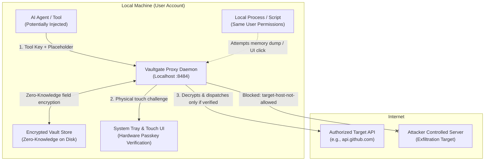

# Vaultgate Security Architecture & Technical Threat Model

> **Status:** Production Design Reference  
> **Classification:** Public Technical Documentation & Code Reviewer Guide  
> **License:** GPL-3.0  
> **Source Repository:** [kimVanRenterghemNew/Vaultgate](https://github.com/kimVanRenterghemNew/Vaultgate)

---

## 1. Executive Summary & Core Paradigm

**Vaultgate** is a zero-knowledge local credential mediation proxy and security daemon designed specifically for autonomous AI agents, coding assistants (e.g., Claude Code, Cursor, Aider, Roo Code), and local LLM tool chains.

Traditional secret management paradigms assume that the client executing an HTTP request must possess the plaintext API key. In the context of generative AI, this paradigm is fundamentally broken:
- Any secret residing in an LLM context window can be extracted via prompt injection, indirect context poisoning, model jailbreaks, or exfiltrated through untrusted plugins and third-party tools.
- Once a credential enters an agent's memory, prompt history, or terminal log, it must be considered permanently compromised.

Vaultgate resolves this dilemma by decoupling **secret authorization** from **secret possession**:
1. Agents never receive plaintext credentials. Instead, they are issued **ephemeral, localized tool keys** and utilize opaque **placeholders** (e.g., `{{secret:github_token}}`).
2. Plaintext secrets exist solely inside the isolated Vaultgate daemon process memory.
3. Decryption occurs strictly at the outbound transport layer for a single HTTP request, exclusively when all policy, routing, placement, and cryptographic validation gates pass.
4. Outbound server responses are scrubbed in real-time across chunk boundaries, neutralizing reflection or echo attacks.
5. High-privilege transitions (granting durable access, pairing new tools, or accessing sensitive keys) mandate **physical cryptographic proof-of-presence** (FIDO2 / WebAuthn passkey touch), rendering software-only UI Automation malware incapable of silently elevating privileges.

---

## 2. Threat Model & Adversary Assumptions



### 2.1 Threat Actors in Scope
1. **Compromised AI Agent (Prompt Injection / Context Hijacking):** An agent whose prompt context has been hijacked via web scraping, poisoned repository commits, issue descriptions, or rogue plugins. The attacker commands the agent to exfiltrate keys.
2. **Untrusted / Buggy Tools:** External scripts or dependencies that write environmental variables or request payloads to unencrypted log files, terminal traces, or telemetry endpoints.
3. **Network Intermediary (MitM):** A rogue proxy, compromised Wi-Fi captive portal, or untrusted corporate inspection certificate attempting to intercept decrypted credentials in transit.
4. **Stolen Backup or Drive Image:** Physical theft or unauthorized backup access of the user's hard drive while the vault is locked.
5. **Local User-Level Malware (Script / PowerShell):** Malicious software executing in the same user session attempting to simulate clicks, read configuration files, or hijack local network sockets.

### 2.2 Out of Scope
- Kernel-level rootkits, hypervisor compromises, or OS-level ring 0 keyloggers.
- Physical compromise of hardware cryptographic tokens (YubiKey, Titan).
- Cold-boot attacks or hardware RAM probing against active memory while the vault is in an unlocked state.

---

## 3. The 22 Attack Vectors & Defense Verification Matrix

The Vaultgate test bench runs an automated attack suite (`npm run attack`) simulating adversarial behavior directly against running daemon instances. Every vector is validated against real code:

| ID | Attack Vector | Adversary Objective | Vaultgate Countermeasure | Status | Enforcement Layer |
|---|---|---|---|---|---|
| **A1** | Direct read of tool key storage (`clients/<tool>.key`) | Impersonate paired tool | Tool keys are stored solely as keyed HMACs; compromised keys only yield limited, revocable grants; placeholder locations remain enforced. | **BLOCKED** | Storage / Registry |
| **A2** | Rogue tool pairing via RFC 8628 Device Flow | Connect unauthorized agent | Existing tool names rejected (`name_taken`); pairing requires visual code verification and physical FIDO2 touch. | **BLOCKED** | Device Flow / Auth |
| **A3** | UI Automation / Synthetic Clicks (SendKeys, .NET) | Silently click "Allow" on tray dialog | Approval buttons disabled for initial 1.5s; persistent grants and sensitive secrets mandate FIDO2 User Verification (physical touch). | **BLOCKED** | UI / WebAuthn |
| **A4** | Tampering with daemon or tray source scripts | Bypass approval / modify decision logic | Startup file hash verification sealed by vault key (Backlog Story 9.2); Ed25519 signature bootstrap verification; protected OS directory; Sigstore CI provenance (`npm publish --provenance`, Story 7.1). | **MITIGATED** | OS Packaging / Core |
| **A5** | Reading process memory (`ReadProcessMemory`) | Extract vault key while unlocked | Ephemeral in-memory lifetimes; auto-lock on idle; zeroing of sensitive buffers. Note: V8 string engine memory limitations acknowledged. | *OPEN (Mitigated)* | Memory Hygiene |
| **A6** | Offline brute-forcing of vault files | Crack vault ciphertext | 32-byte random vault key (never derived from password); Argon2id (256 MiB RAM) for passphrase; WebAuthn PRF hardware derivation. | **BLOCKED** | Libsodium KDF |
| **A7** | Stealing portal session cookies | Alter policies, add rogue hosts | `HttpOnly`, `SameSite=Strict`, CSRF tokens, strict Host header checking (`421 Misdirected`), dedicated isolated browser profile. | **BLOCKED** | Portal Engine |
| **A8** | Prompt injection: send secret to rogue host | Exfiltrate secret value | Strict host allowlist per secret; requests to unauthorized hosts rejected with `target-host-not-allowed` prior to decryption. | **BLOCKED** | Policy Engine |
| **A9** | Prompt injection: send secret in query/body | Leak secret into server URL logs | Fine-grained placement policy per secret (defaults strictly to `header:authorization`). Blocked with `placeholder-location-not-allowed`. | **BLOCKED** | Policy Engine |
| **A10** | Echo attack: target host echoes request | Exfiltrate secret via agent reply | Real-time streaming response scrubber removes raw secret, 3 base64 offset alignments, and hex representations across chunk borders. | **BLOCKED** | Stream Scrubber |
| **A11** | Scope abuse: agent calls unauthorized path | Misuse allowed secret | Granular path prefix matching and method constraints per grant; interactive tray approval displays full HTTP method and path. | **BLOCKED** | Routing & Grants |
| **A12** | Sabotaging audit log (disk full / lock) | Stealth exfiltration without trace | Write-ahead logging: decision written before secret decryption; fail-closed (`audit-unavailable`); auto-lockdown after 3 consecutive errors. | **BLOCKED** | Audit Engine |
| **A13** | Man-in-the-Middle / Corporate CA spoofing | Intercept plaintext credential | Strict TLS checking; Trust-On-First-Use (TOFU) pinning. If certificate issuer or root changes, request halts at handshake (`tls-chain-changed`). | **BLOCKED** | TLS Layer |
| **A14** | DNS rebinding / Browser-based CSRF | Issue unauthorized local commands | Strict Host header validation (`127.0.0.1` / `localhost` only, returns `421`); strict JSON Content-Type validation (`415 Unsupported Media`). | **BLOCKED** | HTTP Dispatcher |
| **A15** | DoS & brute-force token guessing | Flood daemon / guess tool keys | Tarpitting: after 5 failed keys in 3 minutes, client is rate-limited with exponential backoff and connection delays. | **BLOCKED** | Throttle Engine |
| **A16** | Keep-alive spam to prevent auto-lock | Prolong memory exposure window | Invalid tool keys or unauthorized requests do not reset the auto-lock inactivity timer. | *OPEN (Roadmap 9.8)* | Session Manager |
| **A17** | Rogue browser extension injection | Intercept secret entry in portal | Dedicated Edge/Chromium app-mode instance launched with isolated profile and `--disable-extensions`. | **BLOCKED** | Launcher |
| **A18** | OS clipboard / Keystroke logger | Steal secret on entry | Passkey-based unlock (no password typed); secret values inputted once and never redisplayed in any UI or API response. | **BLOCKED** | Portal View |
| **A19** | Hijacking CLI helper script (`apiKeyHelper`) | Intercept tool credentials | Tool keys are scoped strictly to assigned grants; compromised keys cannot access ungranted secrets; single-click revocation. | **BLOCKED** | CLI Registry |
| **A20** | Named Pipe impersonation for tray approval | Forged approval responses | Cryptographic one-time token exchanged over stdin at process initialization; rogue pipes rejected without valid handshake token. | **BLOCKED** | IPC Layer |
| **A21** | Killing the daemon process | Bypass security checks | Fail-closed network configuration: tools configured with local proxy endpoints cannot reach external hosts if the proxy is terminated. | **BLOCKED** | Architecture |
| **A22** | Rollback of vault storage / old state replay | Re-enable revoked tool keys | MAC covering header, public keys, and record version manifest (`{recordId: version}`). Mismatches halt unlock with `VAULT_TAMPERED`. | **BLOCKED** | Vault Engine |

---

## 4. Module Architecture & Engineering Conventions (Hexagonal Ports & Adapters)

Vaultgate enforces clean architecture principles. Code is partitioned strictly into functional domains adhering to Dependency Inversion:

```
 tool (Claude Code, Cursor, Agent)             portal (browser, 127.0.0.1)
        │  HTTP(S) + tool-key + {{secret:x}}          │ FIDO2-login
        ▼                                             ▼
 ┌─────────────────────────── Vaultgate (Single Node Process) ───────────────────────────┐
 │ ingress ─► policy ─► approval ─► vault ─► egress ─► (target host) ◄─ scrub ◄─ response │
 │                                   ▲                                                   │
 │ portal-api ───────────────────────┘          audit (encrypted, append-only)          │
 └───────────────────────────────────────────────────────────────────────────────────────┘
        ▲ local socket + stdin token
        │
 tray-app (isolated helper): approval popups, locked/unlocked state
```

### 4.1 Module Responsibility Matrix
Every folder corresponds to a discrete module with a strict public interface defined exclusively via `index.js`:

| Module | Core Responsibility | External Dependencies / Injected Ports |
|---|---|---|
| `src/vault/` | Key hierarchy, AEAD field encryption/decryption, locking/unlocking lifecycle | `crypto`, `store`, `clock` |
| `src/store/` | Storage backend (encrypted local file store; external vaults planned) | `fs` |
| `src/registry/` | Domain layer: secrets, tools (key HMACs), grants, settings; never outputs plaintext values | `vault`, `clock`, `crypto` |
| `src/crypto/` | Cryptographic primitives wrapping Libsodium (`sodium-native`) | None (Libsodium C-bindings) |
| `src/policy/` | Tool key authentication, host matching, placement validation, rule evaluation | `vault` (names & rules only) |
| `src/approval/` | Tray approval coordination, timeout enforcement (default 30s), escalation | `notifier`, `clock` |
| `src/proxy/` | Ingress parsing (forward & reverse routes), secret injection, outbound egress, streaming | `policy`, `approval`, `vault`, `scrub`, `audit`, `http` |
| `src/scrub/` | Outbound response stream scrubbing across chunk boundaries | None (Pure string/buffer parser) |
| `src/audit/` | Tamper-evident, encrypted append-only audit logging; never logs secret values | `vault`, `store`, `clock` |
| `src/portal/` | Local loopback HTTP API & UI on `127.0.0.1`, WebAuthn login | `vault`, `policy`, `audit`, `webauthn` |
| `src/device/` | Tool pairing via RFC 8628 Device Flow, ephemeral verification codes | `registry`, `vault`, `audit`, `notifier`, `clock`, `crypto` |
| `src/tls/` | TLS trust store validation and Trust-On-First-Use (TOFU) certificate chain pinning | `registry`, `audit`, `clock` |
| `src/window/` | Isolated browser profile launcher (Edge/Chromium app-mode, extensions disabled) | Operating System process spawn |
| `src/tray-link/` | Secure IPC protocol to desktop tray helper (named pipe + one-time stdin token) | `crypto` |
| `src/decision/` | Pure composition decision kernel: guards, reducers, rule evaluation | None (Pure functional logic) |
| `src/touch/` | FIDO2 user verification assertion coordinator for physical touch confirmation | `clock` |
| `src/throttle/` | Rate-limiting & tarpitting after failed tool key attempts | `clock` |
| `src/composition.js` | The single wiring point that binds port implementations | All concrete adapters |
| `web/portal/` | Browser frontend: vanilla Web Components, DaisyUI/Tailwind, bundled via esbuild | Portal HTTP API |

### 4.2 Architectural Code Invariants
To ensure auditability and maintainability, the codebase adheres to strict invariants verified in CI:
- **No ES6 Classes:** Objects are created via pure factory functions. Errors are tagged plain Error objects with explicit code properties:
  ```js
  export const TARGET_HOST_NOT_ALLOWED = 'TARGET_HOST_NOT_ALLOWED';
  export const targetHostNotAllowed = (host) => 
    Object.assign(new Error(`target host not allowed: ${host}`), { code: TARGET_HOST_NOT_ALLOWED });
  ```
- **Dependency Inversion:** Every module receives external dependencies as explicit parameters (e.g., `createProxy({ policy, approval, vault, scrub, audit, http, clock })`). Zero ambient globals (`process.env`, `Date.now()`, or network calls) exist in the core domain.
- **Single Composition Point:** Only `src/composition.js` instantiates and wires concrete implementations. Bypassing this is caught by `test/composition.test.js`.
- **Public API Boundaries:** External imports must target the module's `index.js`. Sub-file deep imports are forbidden and enforced by `test/moduleApi.test.js`.
- **File Length Limit:** Files are capped at 200 lines to preserve readability and enforce single responsibility (`test/codeStructure.test.js`).

---

## 5. Cryptographic Key Hierarchy & Zero-Knowledge Storage Engine

Vaultgate implements a layered envelope encryption model following the zero-knowledge Bitwarden security architecture, executed via **Libsodium** (`crypto_aead_xchacha20poly1305_ietf`).

```
                +------------------------------------+
                | Hardware Passkey (FIDO2 / WebAuthn)|
                +------------------------------------+
                                   |  WebAuthn PRF (hmac-secret)
                                   v
              [ KDF: crypto_kdf_derive_from_key ]
                                   |
                                   v
                          +------------------+
                          |  KEK (Per Key)   |
                          +------------------+
                                   | Unwraps
                                   v
+------------------------------------------------------------------------+
|                              VAULT KEY                                 |
|         (32 Cryptographically Random Bytes, In-Memory Only)            |
+------------------------------------------------------------------------+
                                   | Wraps
        +--------------------------+--------------------------+
        |                          |                          |
        v                          v                          v
+---------------+          +---------------+          +---------------+
| Item Key (S1) |          | Item Key (G1) |          | Item Key (L1) |
|   [Secret]    |          |    [Grant]    |          |  [Audit Log]  |
+---------------+          +---------------+          +---------------+
        |                          |                          |
        v (Field-by-Field AEAD)    v (Field-by-Field AEAD)    v (Append-Only)
   Name, Value,               Tool, Secret, Host,        Timestamp, Rule,
   Allowed Hosts              Duration, Constraints      Client, Decision
```

### 5.1 Master Vault Key
- Generated via `crypto_secretbox_keygen()` (32 cryptographically secure random bytes).
- **Never derived directly from a password.**
- Stored exclusively in volatile memory while the vault is in an unlocked state.
- Revoking a passkey deletes only that credential's wrapped copy of the Vault Key, avoiding expensive re-encryption of stored secrets.

### 5.2 Hardware-Bound Key Derivation (WebAuthn PRF)
- Utilizes the FIDO2/WebAuthn **Pseudo-Random Function (PRF)** extension (`hmac-secret`).
- When the user touches their physical authenticator, the PRF produces a 32-byte secret derived from the authenticator's internal hardware root:
  $$\text{PRF Output} = \text{HMAC-SHA-256}_{\text{HardwareKey}}(\text{Salt})$$
- The PRF output feeds into `crypto_kdf_derive_from_key`, producing the Key Encryption Key (`KEK_fido`).
- Allows single-touch, passwordless vault unlock without exposing raw master key material to the browser or operating system.

### 5.3 On-Disk Storage Format: "Zero Plaintext at Rest"
The vault storage comprises encrypted records on disk. 

**Unencrypted Metadata (Inspection Safe):**
- Format version identifier (e.g., `v1`).
- KDF parameters and public salts.
- Wrapped Vault Keys per authorized unlock method.
- Opaque, cryptographically random record UUIDs.

**Encrypted Record Fields (`EncString` Specification):**
Every individual attribute is encrypted independently:
$$\text{EncString} = \text{v1}.\text{Nonce}_{\text{base64}}.\text{Ciphertext}_{\text{base64}}$$
Where Nonce is 24 cryptographically random bytes generated via `randombytes_buf`.

### 5.4 Additional Authenticated Data (AAD) Context Binding
To eliminate ciphertext transposition attacks (moving a valid ciphertext between records or from a name field into a secret value field), the Poly1305 AEAD MAC binds to strict context metadata:
$$\text{AAD} = \text{recordId} \parallel \text{fieldPosition} \parallel \text{recordVersion} \parallel \text{formatVersion}$$
If an adversary relocates a valid ciphertext chunk to another field or record, MAC verification fails immediately. Furthermore, the list of field names is itself stored in an encrypted manifest within the record, hiding the record type from disk inspection.

### 5.5 Rollback Protection via Keyed Header Manifest
The storage header contains a Message Authentication Code (MAC) derived from a subkey of the Vault Key:
$$\text{Header MAC} = \text{HMAC-SHA-512-256}_{K_{\text{mac}}}(\text{PublicKeys} \parallel \text{Salts} \parallel \text{VersionManifest})$$
Where:
$$\text{VersionManifest} = \{ \text{recordId}_1: \text{version}_1, \dots, \text{recordId}_n: \text{version}_n \}$$
If an adversary restores an old backup of an individual record (e.g., attempting to resurrect a revoked tool key), the Header MAC fails upon unlock with `VAULT_TAMPERED`, refusing to start.

---

## 6. Gateway Decision Engine & Fail-Closed Logic

Every incoming HTTP request forwarded through Vaultgate passes sequentially down a deterministic, ordered decision table. **The first matching rule decides the outcome.**

```
+--------------------------------------------------------------------+
| 1. Vault Locked?                     --> 423 'vault-locked'        |
| 2. Valid Tool Key?                   --> 401 'no-tool-key'         |
| 3. Tool Key Revoked?                 --> 403 'tool-key-revoked'    |
| 4. Client IP Allowed?                --> 403 'client-not-allowed'  |
| 5. Contains Secret Placeholder?      --> 400 'no-placeholder'      |
| 6. Secret Exists?                    --> 404 'unknown-secret'      |
| 7. Destination Host Whitelisted?     --> 403 'target-host-not-allowed'
| 8. Placeholder in Allowed Header?    --> 403 'placeholder-location-not-allowed'
| 9. Quiet Hours / Active Blocks?      --> 403 'quiet-hours'         |
| 10. Active Durable Grant Exists?     --> 200 'granted' (PASS)      |
| 11. Grant Expired?                   --> 403 'grant-expired'       |
| 12. Interactive Approval in Tray     --> 200 'approved-once' / 403 |
+--------------------------------------------------------------------+
```

### 6.1 HTTP Response & Header Contracts
- The rule name that determined the outcome is returned in the response header:
  `x-vault-gate-rule: <rule-name>`
- Forwarding requests must supply the tool credential via:
  `x-vault-gate-tool-key: vg_...`
- Status code mapping strictly follows security semantics:
  - `401 Unauthorized`: Identity missing, invalid, or timed out (`no-tool-key`, `tool-key-revoked`, `approval-timeout`).
  - `403 Forbidden`: Authenticated tool attempting unauthorized action (`target-host-not-allowed`, `client-not-allowed`, `placeholder-location-not-allowed`, `approval-denied`).
  - `423 Locked`: Vault daemon locked (`vault-locked`).
  - `502 Bad Gateway`: Outbound transport failure or security abortion (`tls-chain-changed`, `upstream-error`).

### 6.2 Write-Ahead Audit Logging
To prevent stealth exfiltration:
1. Every decision is formatted and committed to the encrypted write-ahead audit log **before** secret decryption occurs.
2. If the audit log fails to write (e.g., disk full, write lock), the transaction immediately halts with `audit-unavailable` (fail-closed).
3. If 3 consecutive audit write failures occur, the daemon enters an emergency locked state.

---

## 7. Real-Time Outbound TLS & Stream Scrubbing

### 7.1 Strict TLS Handshake Inspection & TOFU Pinning
Vaultgate inspects the TLS certificate chain during the TLS handshake before writing request payload bytes:
1. **System Trust Store:** Validates certificates against the operating system trust store (including authorized corporate enterprise inspection roots).
2. **Trust-On-First-Use (TOFU) Pinning:** Records the leaf issuer and root certificate fingerprint upon the first verified connection to each target host.
3. **Handshake Interception:** If an unexpected certificate change occurs (e.g., untrusted network proxy, public Wi-Fi captive portal, or unauthorized CA), the handshake aborts immediately via `checkServerIdentity`:
   - Request terminates with HTTP 502 and rule `tls-chain-changed`.
   - Not a single byte of the decrypted request payload leaves the computer.

### 7.2 Multi-Alignment Response Scrubbing
When an upstream server returns an HTTP response, Vaultgate buffers and scrubs data on-the-fly to prevent echoed credentials from reaching the agent:
- Detects plaintext secrets, hexadecimal representations, and all three possible base64 byte alignments.
- **Cross-Chunk Boundary Windowing:** Maintains a sliding buffer spanning chunk boundaries equal to twice the secret length, ensuring secrets split across TCP packets or HTTP chunks are redacted cleanly.

---

## 8. Physical Presence Guarantees & Hardware Touch Protocol

### 8.1 The Limits of Desktop Popups
Standard desktop operating systems do not isolate UI interactions between applications running under the same user account. Any local script can leverage Windows UI Automation, Accessibility APIs, or `SendKeys` to locate and trigger dialog buttons.

### 8.2 Hardware-Backed Defense
Vaultgate neutralizes UI Automation attacks through strict hardware gating:
1. **1.5-Second Interactive Delay:** The tray popup disables confirmation controls for 1500 ms upon display to disrupt rapid programmatic event dispatchers.
2. **Mandatory FIDO2 Touch Assertion:**
   - Single-use permissions ("Allow Once") permit strictly one HTTP transaction.
   - Any action establishing persistent access (creating a 30-minute, 4-hour, or permanent grant, pairing a new tool, or accessing secrets flagged as *sensitive*) triggers a WebAuthn assertion dialog requiring a **physical touch of a security key or biometric confirmation**.
   - Because physical capacitive touch cannot be synthesized by software, local malware cannot silently escalate its privileges.
3. **Touch Protocol Implementation:**
   - The daemon opens the dedicated portal window at `/touch#<id>` where `<id>` is a 256-bit one-time cryptographic nonce with a 2-minute time-to-live.
   - The challenge is cryptographically bound to that nonce.
   - Settings permit enforcing `touchAuthenticator: external`, requiring physical USB/NFC/BLE tokens (YubiKey) rather than software-based PINs.

---

## 9. Agent Onboarding: RFC 8628 Device Flow

AI tools and agents pair with Vaultgate using an RFC 8628 Device Authorization Flow adapted for secure local environments:

```
Agent CLI                                  Vaultgate Daemon                       System Tray / User
   │                                              │                                       │
   │ 1. POST /device/code (tool: "claude-code")   │                                       │
   ├─────────────────────────────────────────────►│                                       │
   │                                              │ 2. Prompts user with code             │
   │ 200 { device_code, user_code: "ABCD-EFGH" }  │──────────────────────────────────────►│
   │◄─────────────────────────────────────────────┤                                       │
   │                                              │                                       │ 3. User verifies code
   │                                              │                                       │    & touches passkey
   │ 4. POST /device/token (polls with code)      │ 4. Validated with physical touch      │
   ├─────────────────────────────────────────────►│◄──────────────────────────────────────┤
   │                                              │                                       │
   │ 200 { tool_key: "vg_..." } (Delivered ONCE)  │                                       │
   │◄─────────────────────────────────────────────┤                                       │
```

- **Ephemeral Storage:** The `device_code` is a 256-bit entropy token held only as a keyed HMAC in daemon memory, expiring after 10 minutes.
- **Physical Touch Required:** Establishing durable tool pairing mandates a physical FIDO2 touch assertion.
- **Single-Delivery Contract:** The plaintext tool key is delivered exactly once across the loopback channel upon successful pairing. Only its keyed HMAC is recorded in the vault registry.

---

## 10. Application & Deployment Integrity (Runtime & Supply-Chain Hardening)

Defending against autonomous agents requires ensuring the agent cannot modify Vaultgate's own executable files or tray scripts on disk (e.g., patching `policy` checks or altering `windows-tray.ps1` to auto-approve requests).

### 10.1 Startup Code & Tray Hash Verification (Backlog Story 9.2)
- **Vault-Sealed Hashes:** The expected cryptographic hashes of all runtime JavaScript modules and the PowerShell tray script (`windows-tray.ps1`) are sealed in the vault using a key derived during vault initialization.
- **Fail-Closed Startup:** At boot, Vaultgate recalculates hashes for all core files before initializing IPC or opening the proxy port. If any script has been modified, the daemon halts immediately, refuses to unlock, and flags the status as `INTEGRITY_COMPROMISED`.
- **Dual Visual Alerting:** An integrity violation triggers a system tray warning and a persistent, high-visibility red banner across the web portal (identical to the `tls-chain-changed` alarm pattern).

### 10.2 Asymmetric Ed25519 Code Signatures (Zero-Budget Integrity)
To protect distributed JavaScript bundles without requiring commercial Authenticode certificates (€400+/year):
1. **Single-File Bundling:** Production builds bundle all source files into a single minified bundle: `dist/vaultgate.cjs`.
2. **Release Signing:** CI signs the bundle using an Ed25519 private key, producing `dist/vaultgate.sig`.
3. **Bootstrap Verification:** The entry point (`bin/vaultgate.js`) verifies the bundle with a hardcoded public key before execution:
   ```js
   const isValid = crypto.verify(null, bundle, PUBLIC_KEY, signature);
   if (!isValid) {
     console.error('[FATAL] Code tampered with: signature invalid');
     process.exit(1);
   }
   await import('../dist/vaultgate.cjs');
   ```
4. **Mathematical Guarantee:** An agent modifying `vaultgate.cjs` cannot forge an Ed25519 signature without the private key stored securely in GitHub Actions secrets.

### 10.3 OS-Level Filesystem Protection (Backlog Stories 0.8 & 7.1)
- Standard operating system user environments permit local processes to write to user-space directories (`%APPDATA%`, `~/.config`).
- Vaultgate's deployment model separates executable code from mutable data. Packaging installs binaries into a protected directory (e.g., `%ProgramFiles%` / system root) that requires UAC administrator elevation to write.
- As a result, an AI agent running under standard user privileges cannot overwrite the daemon executable or inject rogue approval logic into the tray.

### 10.4 Release Provenance & Clean Surface Packaging (Backlog Stories 7.1 & 7.3)
- **Cryptographic Provenance:** Official packages published to npm (`npx vaultgate`) utilize GitHub Actions with Sigstore OIDC attestation (`npm publish --provenance`), creating an unforgeable public record linking the artifact directly to the verified commit in the public repository.
- **Strict Clean-Export Automation:** Deployments are generated via automated release scripts (`release-export.mjs`) that squash public changes and strictly omit test mocks, developer spikes, internal backlog documents, and secrets.

---

## 11. Security Auditor & Code Reviewer Checklist

When reviewing pull requests or auditing the Vaultgate codebase, reviewers must verify compliance against the following non-negotiable rules:

- [ ] **No Secret Strings:** Secrets must be processed exclusively as Node.js `Buffer` objects where feasible. Secret values must never be cast to strings in logging, audit formatting, or error paths.
- [ ] **No Unscrubbed Egress:** Every outbound response path must pass through `src/scrub/` before emitting bytes to the client socket.
- [ ] **Fail-Closed Policy Guards:** All decision branches in `src/policy/` must default to deny. Every denial must yield a discrete, named rule matching the decision table.
- [ ] **Zero Leaks in Portal API:** Portal responses (`src/portal/`) must never return secret values. All user journeys must pass automated `findLeaks` assertions.
- [ ] **Write-Ahead Audit Guarantee:** Secret decryption must occur strictly after audit write completion.
- [ ] **No Ambient Globals:** No direct access to `process.env`, `Date.now()`, or network sockets inside domain modules; dependencies must be passed via port parameters.
- [ ] **Boundary & Format Constraints:** Files must remain under 200 lines; module imports must strictly target `index.js`.

---

## 12. Summary of Principles

| Principle | Technical Implementation |
|---|---|
| **Zero Plaintext at Rest** | Libsodium XChaCha20-Poly1305 field-level AEAD with Argon2id and FIDO2 PRF derivation. |
| **Fail-Closed Execution** | Write-ahead auditing; missing logs halt requests with `audit-unavailable`; 3 errors lock vault. |
| **Zero Credential Exposure** | Placeholders used throughout agent lifecycles; values never rendered in APIs or UI. |
| **Strict Boundary Enforcement** | Fine-grained host allowlists and request header placement restrictions per secret. |
| **Physical Proof of Intent** | WebAuthn hardware user verification for persistent permissions and sensitive secrets. |
| **Application Integrity** | Ed25519 code signing, startup hash verification, OS directory isolation, Sigstore CI provenance. |
| **Verifiable Proof Bench** | Automated suite (`npm run attack`) testing 22 explicit exploit patterns against the live engine. |
